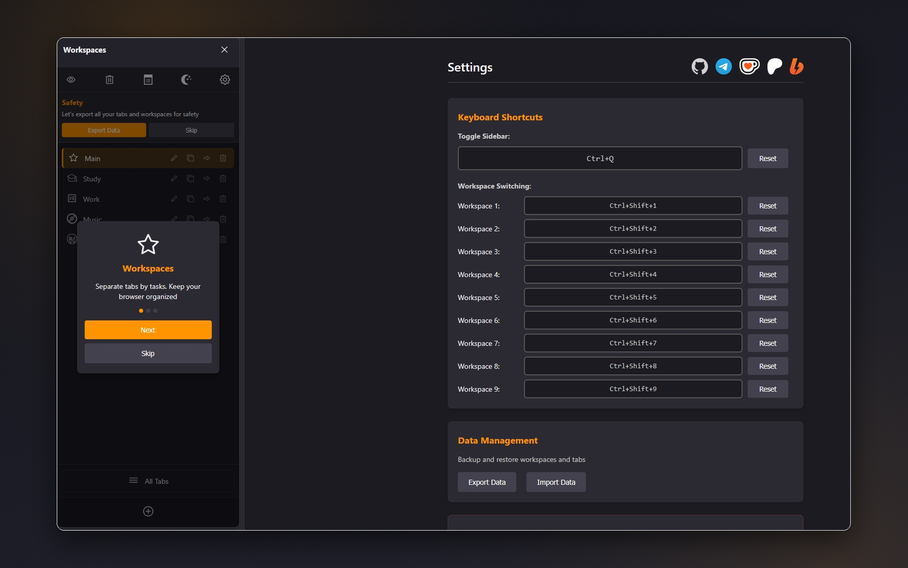
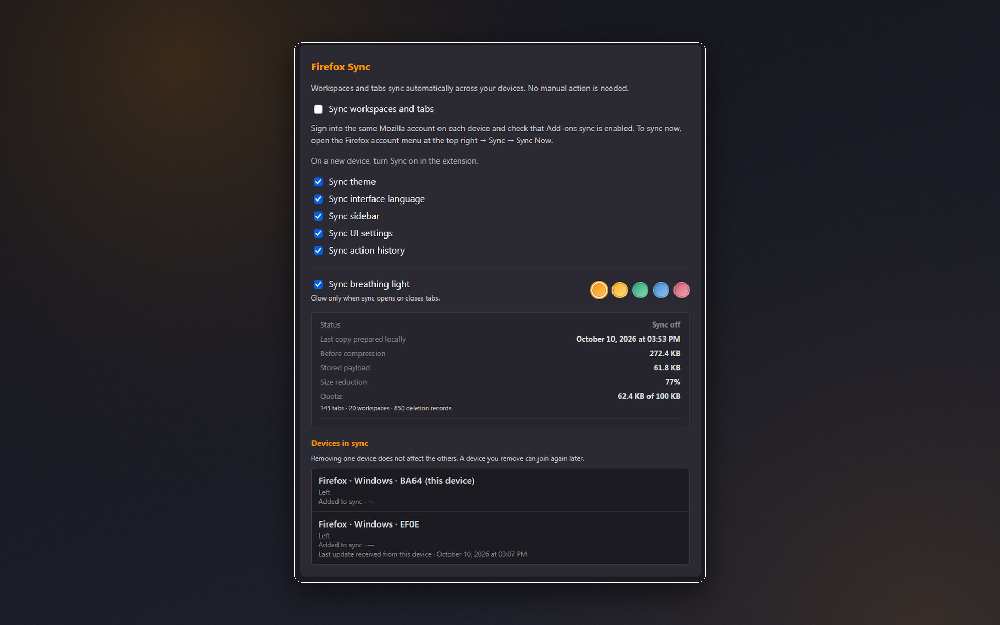
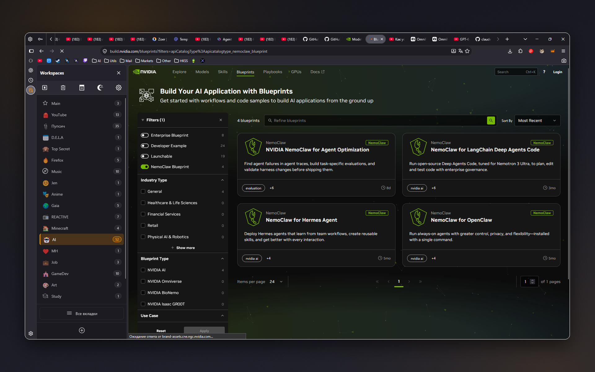
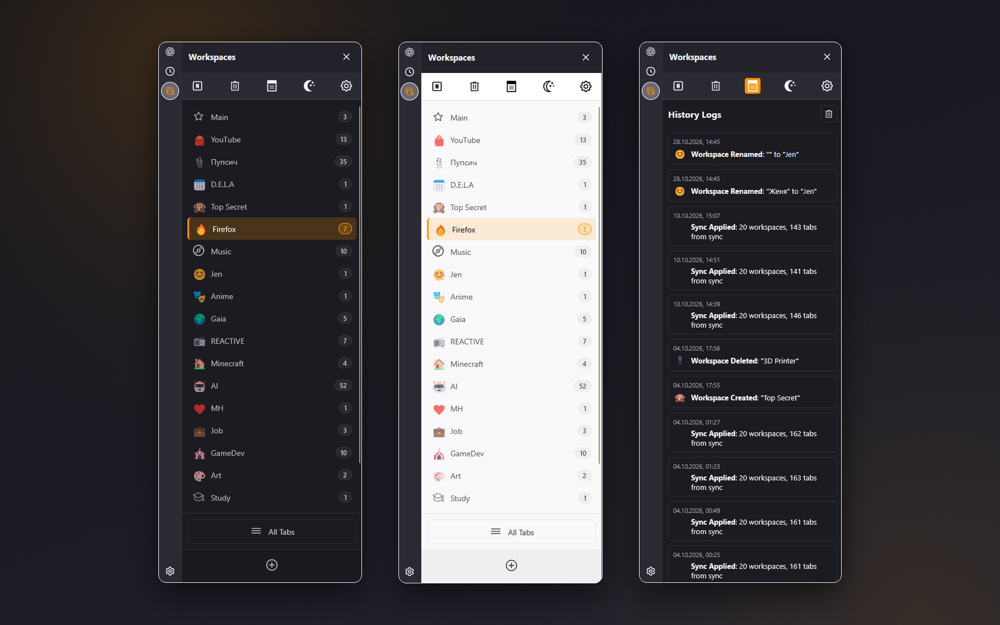
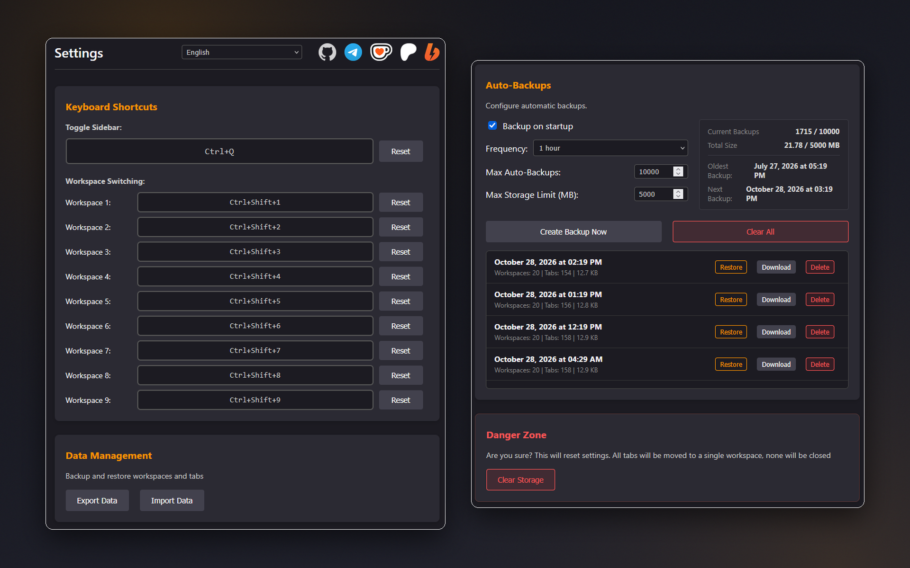
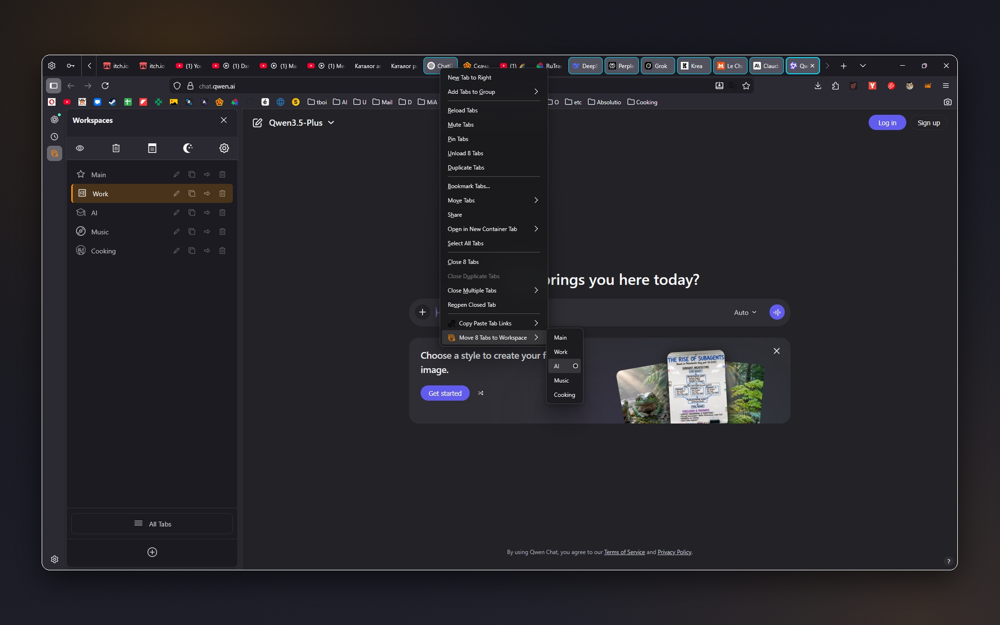
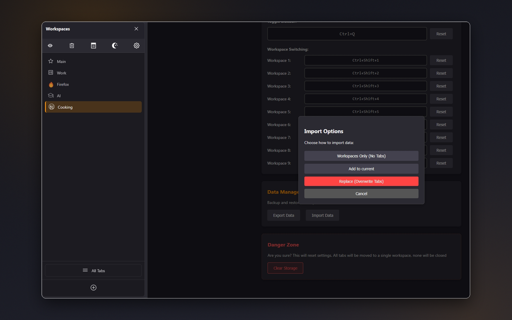

# Workspaces

Organize tabs into dedicated workspaces, switch instantly from a clean sidebar, and keep related tabs hidden until you need them. Sync workspaces and tabs between your computers with Firefox Sync – no extra account.

**[Install from addons.mozilla.org](https://addons.mozilla.org/firefox/addon/workspaces-sidebar/)**

## Screenshots

| | |
|:---:|:---:|
|  Quick onboarding on first launch: separate your tabs by task and keep your browser organized. |  Sync workspaces and tabs between your computers with Firefox Sync – choose what to sync, check the quota, and see every device in sync. |
|  Only the active workspace's tabs are shown in the tab bar; every workspace in the sidebar shows how many tabs it holds. |  Clean sidebar in dark and light themes, with emoji or custom icons, tab counters, and a history log of every change. |
|  Keyboard shortcuts for the sidebar and workspaces 1–9, interface language, JSON export/import, and automatic backups with one-click restore. |  Move one tab or several selected tabs to any workspace from the tab context menu. |
|  Import a backup your way: workspaces only, merge with the current setup, or replace everything. |  |

## Features
- **Workspace organization** – create, rename, delete and reorder workspaces in the sidebar. Pick emoji or custom icons, drag and drop to reorder, and see how many tabs each workspace holds.
- **Move tabs and stay focused** – move one tab or several highlighted tabs to any workspace from the tab context menu. **All Tabs** mode reveals everything at once.
- **Sync across your computers** – workspaces and their tabs sync between Firefox desktop computers through Firefox's built-in sync. There's no separate account or server: sign in to the same Mozilla account and keep Add-ons enabled in Firefox Sync.
  - Workspace names, icons, order, and every workspace's tabs (full addresses, duplicates included)
  - Tabs you open or close follow you, and closed tabs don't come back from another device
  - Optionally sync the theme, interface language, sidebar options and auto-backup settings
  - On a new device, choose once: use the synced copy, upload this device, or merge both
  - See every device in sync, disconnect one without deleting anything, and reconnect it later
  - A soft glow in a color you choose and a compact progress indicator show when sync opens or closes tabs
- **Automatic backups and restore** – from every 5 minutes to once a week, or on startup. Set limits on count and size, restore in one click, export everything to JSON and import with merge or replace, or restore only workspaces.
- **Bulk actions** – move all tabs between workspaces, close only one workspace's tabs, copy all of a workspace's URLs.
- **History and undo** – every create, rename, move and delete is logged, with undo/redo.
- **Keyboard shortcuts and themes** – open the sidebar and jump to workspaces 1–9 with shortcuts. Light and dark themes are supported.

History logs and backups stay on each device. Synced data is compressed to fit Firefox's 100 KB add-on sync limit; for very large sessions, use JSON export.

## Technical details
- Manifest V3, tab hide/show for workspace isolation
- Data is stored locally. When sync is on, it travels only through your own Firefox Sync (Mozilla account)
- **No data collection**, tracking, or analytics

## Localization
Translated into **19 languages**: English, Spanish, German, French, Russian, Belarusian, Chinese (Simplified and Traditional), Japanese, Portuguese, Italian, Korean, Polish, Dutch, Turkish, Ukrainian, Indonesian, Arabic, and Vietnamese.

## Support
[Telegram](https://t.me/kustric) · [Ko-fi](https://ko-fi.com/kustrica) · [Patreon](https://www.patreon.com/kustrica) · [Boosty](https://boosty.to/kustrica)
